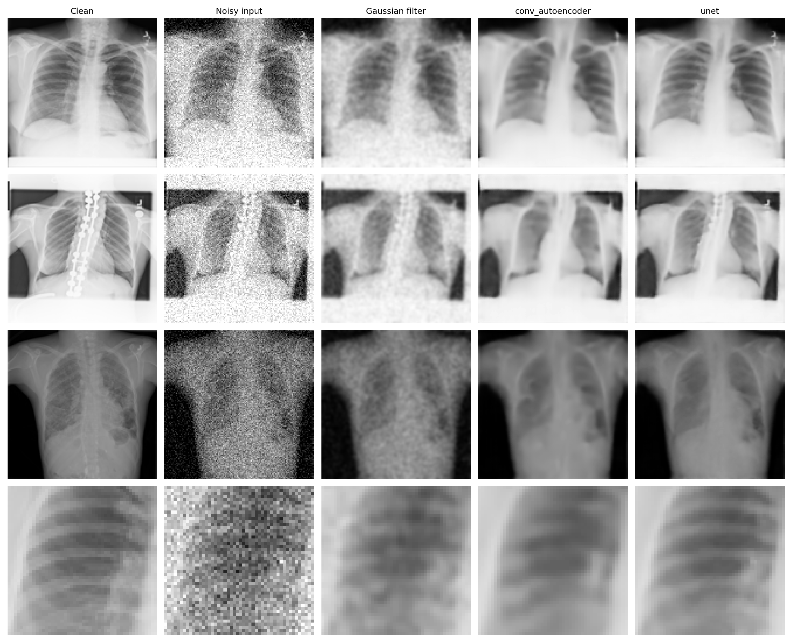
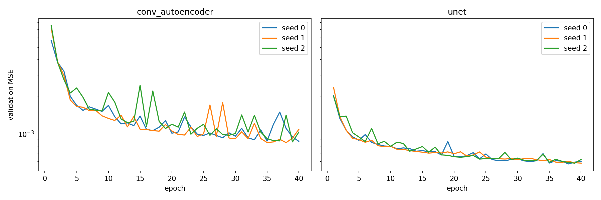

# Deep Learning for X-ray Denoising

Lowering the radiation dose of an X-ray protects the patient, but makes the image noisier.
This project asks whether deep learning can remove that noise better than a classical filter,
and whether **skip connections** help preserve fine anatomical detail.

**Key result:** on chest X-rays, a U-Net reaches a test MSE **2.2× lower** than a tuned Gaussian filter
and **33% lower** than an identical autoencoder without skip connections.



*Three test images (rows 1–3) and a zoom on the ribs (row 4). The autoencoder blurs rib edges and almost erases the spinal implant in row 2; the U-Net keeps both.*

## Research questions

- **H1** – Do convolutional networks, which *learn* their kernels from data, clearly outperform a classical Gaussian filter, whose kernel is *fixed* by a formula?
- **H2** – Do skip connections improve reconstruction, by carrying fine details past the bottleneck?

## Data

- **NIH ChestX-ray14**, first archive (`images_001.tar.gz`), plus the metadata CSV.
- Only **PA (posteroanterior) views** kept, as they are more homogeneous: **3,290 images from 1,264 patients**.
- Resized from 1024×1024 to **128×128**, grayscale, normalised to [0, 1].
- **Split by patient** (2,274 / 503 / 513 images), so the same chest never appears in both training and test.
- **Gaussian noise, σ = 0.1**, as an approximation of low-dose noise. During training it is added by a Keras `GaussianNoise` layer (new noise at every step, acting as data augmentation); validation and test noise is generated once with fixed seeds, so all methods are evaluated on the same noisy images.

Disease labels are not used: the target is the clean image itself. See [`data/README.md`](data/README.md) to download the data.

## Methods

| Method | Description | Parameters |
|---|---|---|
| Gaussian filter | Classical baseline, no learning; width σ = 1.25 px chosen on the validation set | – |
| Convolutional autoencoder | Encoder 32 → 64 → 128 filters, undercomplete 16×16×32 bottleneck, transposed-convolution decoder | 736k |
| U-Net | Same network **plus skip connections** – the only difference | 929k |

**Training (identical for both networks):** MSE loss · Adam, learning rate 10⁻³ · batch size 32 · 40 epochs, keeping the weights with the lowest validation MSE · 3 random seeds per network.
Hyperparameters were deliberately not tuned per model, to keep the comparison fair.

## Results

Test set: 513 images never used for training or tuning. Networks: mean ± std over 3 seeds.

| Method | Test MSE |
|---|---|
| Noisy input (no denoising) | 0.009222 |
| Gaussian filter | 0.001287 |
| Convolutional autoencoder | 0.000875 ± 0.000007 |
| **U-Net** | **0.000584 ± 0.000005** |

- **H1 confirmed:** learned kernels beat the fixed filter – the U-Net error is 2.2× lower, the autoencoder's 1.5× lower.
- **H2 confirmed:** skip connections reduce the error by 33%, a gap about 40 times larger than the spread between seeds. The U-Net also trains more stably:



## Limitations

- Noise is synthetic Gaussian, not real (Poisson-like) low-dose acquisition noise.
- Reference images are not perfectly clean: 8-bit, already slightly noisy; 128×128 loses the finest details.
- One archive of the dataset and PA views only.
- The U-Net has 26% more parameters than the autoencoder.
- Best epochs were 38–40, so both networks might improve with longer training.
- A low MSE does not guarantee that small lesions are preserved: no clinical evaluation was done.

## Repository structure

```
├── notebooks/xray_denoising.ipynb   # full pipeline, with outputs: data, noise, models, training, evaluation
├── slides/                          # project presentation (PDF)
├── results/
│   ├── test_results.csv             # test MSE per method
│   └── figures/                     # visual comparison and learning curves
├── data/README.md                   # how to obtain the dataset
└── requirements.txt
```

## How to run

1. Download the data as described in [`data/README.md`](data/README.md) and put it in your Google Drive.
2. Open [`notebooks/xray_denoising.ipynb`](notebooks/xray_denoising.ipynb) in Google Colab with a GPU runtime and set `BASE` to your folder.
3. Run all cells (training takes a few minutes per model on a T4 GPU).

Built with **Python, TensorFlow/Keras, NumPy, pandas, scikit-learn, SciPy**.

## Notes

Developed as the project for a university Deep Learning course.
Claude (Anthropic) was used as a coding assistant; research questions, experimental design and analysis are my own.
